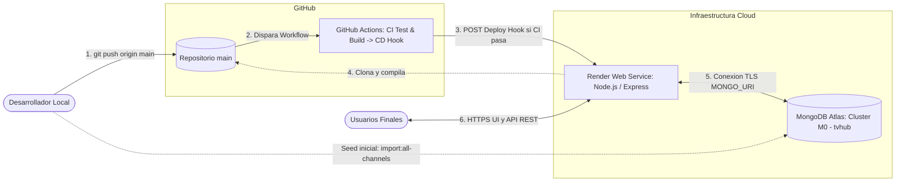

# TV Hub — Prácticas Integradoras 1 y 3

Aplicación web full-stack desarrollada con **Node.js, Express, TypeScript, MongoDB y Mongoose** para la gestión, visualización y reproducción de canales de televisión en vivo mediante listas M3U, desplegada en la nube con integración y entrega continua (**GitHub Actions + Render + MongoDB Atlas**).

---

## 🌐 Aplicación Desplegada (Producción)

- **URL Pública:** `https://practic3-cd-ci.onrender.com` 
- **Health Check:** `GET /health` (verifica disponibilidad del servidor Express)
- **Readiness Check:** `GET /ready` (verifica conexión activa con MongoDB Atlas)

### Guía rápida de uso para el usuario final
1. **Explorar canales (Público):** Al ingresar a la página principal (`/`), la aplicación consulta `GET /api/channels` y muestra los canales activos agrupados por país (hasta 5 por país) con opción de filtrado por categoría o búsqueda por nombre.
2. **Ver todos los canales de un país:** Selecciona un país para navegar a la vista dedicada (`/country.html`) con el catálogo completo de esa región.
3. **Reproducir transmisión:** Haz clic en cualquier tarjeta de canal para abrir el reproductor (`/watch.html`), el cual obtiene los metadatos del stream y utiliza **Shaka Player** para reproducir señales HLS/DASH *(la reproducción depende de que el proveedor del stream remoto habilite CORS)*.
4. **Registro e Inicio de Sesión:** Crea una cuenta en `/register` o inicia sesión en `/login`. La sesión se gestiona de forma segura mediante cookies `HttpOnly` con rotación de *Refresh Tokens*.
5. **Gestión de Favoritos:** Una vez autenticado, puedes marcar o desmarcar canales como favoritos desde el inicio o consultar tu lista personalizada en `/favorites.html`, con opciones de búsqueda y ordenamiento.

---

## 📋 Alcance Técnico del Proyecto

### Práctica Integradora 1 (Aplicación MVC y Reproducción)
- Autenticación completa (`/api/auth/*`) con contraseñas cifradas (`bcryptjs`) y *Refresh Tokens* almacenados como hash SHA-256 en MongoDB.
- Modelo `Channel` alimentado mediante el parser backend de playlists `.m3u` (`src/utils/m3u-parser.ts`).
- Flujo MVC completo para canales, favoritos (`Favorite` con índice único compuesto `userId` + `channelId`) y vista de reproducción con Shaka Player.

### Práctica Integradora 3 (Nube, Persistencia Remota y CI/CD)
- **Persistencia en MongoDB Atlas:** Conexión externa mediante `MONGO_URI` sin credenciales expuestas en el repositorio y carga inicial de canales mediante scripts compilados.
- **Despliegue en Render (Web Service):** Ejecución en producción sobre puerto dinámico (`process.env.PORT`), serving de archivos estáticos compilados (`dist/public`) y monitoreo mediante `/ready`.
- **Pipeline Automatizado (GitHub Actions -> Render):** Workflow en `.github/workflows/ci-cd.yml` que valida pruebas automatizadas (`Jest` + `mongodb-memory-server`) y compilación TypeScript en cada `push` a `main`, disparando el despliegue en Render únicamente si el CI concluye con éxito.

---

## 🏗️ Arquitectura

El backend sigue el patrón **Route → Controller → Mongoose Model → MongoDB**:
- **Canales:** `channel.routes.ts`, `channel.controller.ts`, `channel.model.ts` y `src/public/js/home.js`.
- **Favoritos:** `favorite.routes.ts`, `authenticate.middleware.ts`, `favorite.controller.ts` y `favorite.model.ts`.
- **Frontend:** HTML5, CSS3 y JavaScript vanilla con `fetch` nativo y Shaka Player.



---

## 💻 Ejecución en Entorno Local

### Requisitos
- **Node.js** 20 o superior
- **Docker** y **Docker Compose** (para MongoDB local)

### Instalación y Arranque
1. Clonar el repositorio e instalar dependencias:
   ```bash
   npm install
   ```
2. Levantar la base de datos MongoDB local con Docker:
   ```bash
   docker compose up -d
   ```
3. Compilar TypeScript y copiar archivos estáticos:
   ```bash
   npm run build
   ```
4. Poblar la base de datos local con las playlists `.m3u` de `docs/`:
   ```bash
   npm run import:all-channels
   ```
5. Iniciar el servidor en modo desarrollo:
   ```bash
   npm run dev
   ```
La aplicación estará disponible en `http://localhost:3000`.

### Variables de Entorno
En desarrollo local, la aplicación utiliza `.env.example` automáticamente como respaldo si no existe un archivo `.env`. Si deseas personalizar valores localmente:
```bash
cp .env.example .env
```

| Variable | Descripción | Ejemplo / Valor |
| :--- | :--- | :--- |
| `PORT` | Puerto del servidor HTTP (inyectado automáticamente en Render) | `3000` |
| `NODE_ENV` | Entorno de ejecución (`development`, `test`, `production`) | `development` |
| `MONGO_URI` | Cadena de conexión a MongoDB local o MongoDB Atlas | `mongodb://localhost:27017/tvhub` |
| `JWT_ACCESS_SECRET` | Clave secreta para firmar Access Tokens (mín. 32 caracteres) | *(Secreto seguro)* |
| `JWT_REFRESH_SECRET` | Clave secreta para firmar Refresh Tokens (mín. 32 caracteres) | *(Secreto seguro)* |
| `ACCESS_TOKEN_TTL` | Tiempo de vida del Access Token | `15m` |
| `REFRESH_TOKEN_TTL` | Tiempo de vida del Refresh Token | `7d` |

---

## 📺 Importación de Canales M3U (Local y Atlas)

Los archivos M3U se procesan exclusivamente en el backend (requieren ejecutar `npm run build` previamente):

- **Importar todas las playlists (`docs/*_playlist.m3u`):**
  ```bash
  npm run build
  npm run import:all-channels
  ```
  *Elimina los documentos previos de `channels` y `favorites`, e inserta todos los canales nuevos conservando usuarios y sesiones.*

- **Importar o actualizar un solo país (sin duplicados):**
  ```bash
  npm run build
  npm run import:channels -- docs/argentina_playlist.m3u Argentina
  ```

- **Poblar MongoDB Atlas desde terminal local (sin guardar secretos en archivos):**
  ```powershell
  # PowerShell
  npm run build
  $env:MONGO_URI="mongodb+srv://<usuario>:<password>@<cluster>.mongodb.net/tvhub?retryWrites=true&w=majority"
  npm run import:all-channels
  Remove-Item Env:MONGO_URI
  ```

---

## ☁️ Despliegue en Render y Pipeline CI/CD

### Configuración en Render (Web Service)
- **Build Command:** `npm ci --include=dev && npm run build`
- **Start Command:** `npm start`
- **Health Check Path:** `/ready`
- **Auto-Deploy:** `No` (controlado exclusivamente por GitHub Actions)

### Flujo CI/CD (`.github/workflows/ci-cd.yml`)
1. **Job `ci` (`Build & Test`):** Se ejecuta en cada `push` a `main`. Instala dependencias (`npm ci`), corre la suite de pruebas (`npm test`) con base de datos en memoria y valida la compilación (`npm run build`).
2. **Job `cd` (`Deploy to Render`):** Depende del éxito de `ci` (`needs: ci`). Envía una petición `POST` al secreto `RENDER_DEPLOY_HOOK_URL` configurado en GitHub Secrets para iniciar el despliegue en producción.

---

## 🛠️ Comandos Disponibles

```bash
npm run dev                  # Inicia servidor de desarrollo con recarga automática (tsx)
npm run build                # Compila TypeScript a dist/ y copia src/public a dist/public
npm start                    # Inicia el servidor compilado en producción (dist/server.js)
npm test                     # Ejecuta pruebas unitarias y de integración con Jest
npm run test:watch           # Ejecuta Jest en modo interactivo
npm run import:all-channels  # Importa todas las playlists M3U de docs/ a MongoDB
npm run import:channels      # Importa una playlist específica (<ruta_m3u> <País>)
```

---

## 🔌 Endpoints de la API

| Método | Endpoint | Descripción | Autenticación |
| :--- | :--- | :--- | :--- |
| `GET` | `/health` | Verifica que el servidor Express esté activo | Pública |
| `GET` | `/ready` | Verifica conexión activa con MongoDB | Pública |
| `POST` | `/api/auth/register` | Registra un usuario nuevo e inicia sesión | Pública |
| `POST` | `/api/auth/login` | Inicia sesión y emite cookies `HttpOnly` | Pública |
| `POST` | `/api/auth/refresh` | Rota el *Refresh Token* y renueva sesión | Cookie |
| `POST` | `/api/auth/logout` | Revoca la sesión actual | Cookie |
| `POST` | `/api/auth/logout-all` | Revoca todas las sesiones activas del usuario | Cookie |
| `GET` | `/api/users/me` | Devuelve el perfil del usuario autenticado | Requerida |
| `GET` | `/api/admin/demo` | Ruta de demostración por rol `ADMIN` | Requerida (Admin) |
| `GET` | `/api/channels` | Lista canales activos (soporta `search`, `category`, `country`, `sort=country`) | Pública |
| `GET` | `/api/channels/:id` | Obtiene el detalle de un canal activo para reproducción | Pública |
| `GET` | `/api/favorites` | Lista los canales favoritos del usuario actual | Requerida |
| `POST` | `/api/favorites/:channelId` | Agrega un canal activo a favoritos | Requerida |
| `DELETE` | `/api/favorites/:channelId` | Elimina un canal de favoritos | Requerida |
